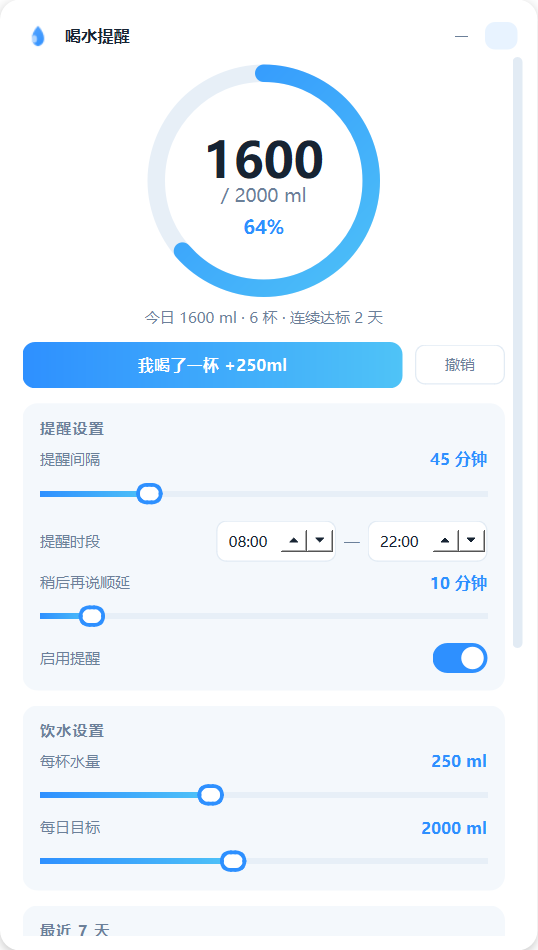
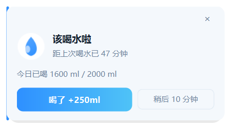
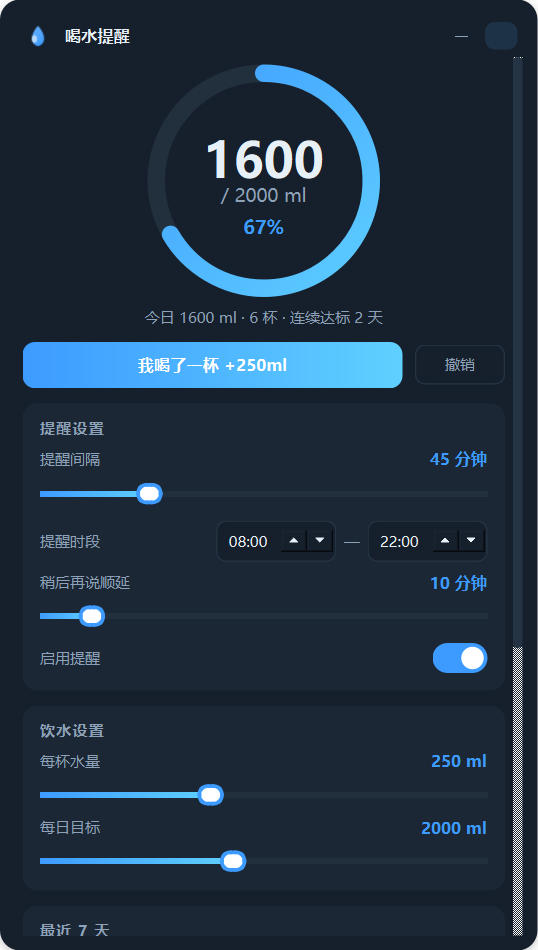
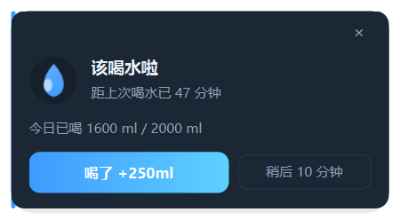

# 喝水提醒 WaterReminder

一个安静、好看的 Windows 桌面喝水提醒工具。到点了只在屏幕**顶部**滑入一张卡片提醒你喝水，**全程不发出任何声音**。




<details>
<summary>深色模式效果</summary>




</details>

## 特性

- **间隔自由可调**：5 ~ 180 分钟滑块随便调，改完立即生效
- **绝对静音**：自绘弹窗，不走系统通知通道，不加载任何音频文件
- **顶部滑入提醒**：从屏幕顶部居中滑入，按钮可直接「喝了 / 稍后 / 跳过」
- **不打扰**：可设提醒时段（默认 08:00–22:00），深夜自动静默
- **饮水统计**：今日进度环、最近 7 天柱状图、连续达标天数，支持打卡与撤销
- **系统托盘常驻**：关闭窗口只是最小化到托盘，右键可打卡、暂停、退出
- **开机自启**：一键写入注册表（不写也完全不影响使用）
- **浅色 / 深色主题**
- **单实例**：重复启动只会唤醒已有窗口

## 快速开始

### 方式一：直接运行 exe（推荐）

1. 到本仓库 Releases 下载 `WaterReminder.exe`；或自己打包（见下方「打包 exe」）
2. 双击运行，任务栏托盘会出现水滴图标

> exe 体积约 40~60 MB（内含 Qt 运行库），Windows 10/11 可用。首次运行若被 SmartScreen 拦截，点「更多信息 → 仍要运行」即可（个人项目未做代码签名）。

### 方式二：源码运行

```bat
安装依赖.bat      :: 首次运行：创建 .venv 并安装 PySide6（国内走腾讯云镜像）
启动喝水提醒.bat  :: 之后每次双击这个即可
```

也可以手动执行：

```bash
python -m venv .venv
.venv\Scripts\python.exe -m pip install -r requirements.txt
.venv\Scripts\pythonw.exe main.py
```

## 使用说明

| 区域 | 说明 |
| --- | --- |
| 提醒间隔 | 5~180 分钟滑块，默认 45 分钟 |
| 提醒时段 | 默认 08:00–22:00，超出时段不弹窗 |
| 稍后再说顺延 | 点「稍后 N 分钟」后，N 分钟后再提醒（默认 10 分钟） |
| 每杯水量 / 每日目标 | 默认 250 ml / 2000 ml |
| 我喝了一杯 | 手动补记一杯，右侧「撤销」可删除最后一次记录 |
| 暂停提醒 | 临时关闭计时，再点一次恢复 |
| 测试提醒 | 立刻预览一次弹窗效果 |

弹窗按钮：**喝了 +250ml**（记录并重新计时）/ **稍后 N 分钟**（顺延）/ **×**（跳过本次）。

## 打包 exe

```bat
打包exe.bat
```

产物在 `dist\WaterReminder.exe`。等价于：

```bash
.venv\Scripts\python.exe -m PyInstaller --noconfirm --clean --onefile --noconsole ^
    --name WaterReminder --icon app.ico --hidden-import PySide6.QtNetwork main.py
```

> `dist/`、`build/`、`*.spec` 已在 `.gitignore` 中忽略，不会推到 GitHub。

## 数据存放位置

配置与饮水记录保存在（不在项目目录，重装/移动项目都不丢）：

```
%APPDATA%\WaterReminder\config.json     # 设置项
%APPDATA%\WaterReminder\history.json    # 每日饮水记录
```

## 目录结构

```
main.py              入口：调度、系统托盘、单实例
core/config.py       配置项读写、开机自启（注册表）
core/store.py        饮水记录与统计（JSON）
ui/theme.py          浅色/深色配色与 QSS
ui/widgets.py        进度环、柱状图、水滴图标、开关（自绘）
ui/main_window.py    主窗口
ui/popup.py          顶部提醒弹窗
_smoke.py            自测脚本（离屏渲染截图 + 逻辑校验）
_make_icon.py        生成 app.ico
安装依赖.bat / 启动喝水提醒.bat / 打包exe.bat
```

## 常见问题

**Q：会有声音吗？**
不会。提醒是普通 Qt 窗口，不播放音频；但托盘气泡走的是 Windows 通知通道，若系统开了通知声音，建议在系统通知设置里静音，或忽略该气泡。

**Q：关了窗口程序还在吗？**
在，最小化到托盘了。托盘图标右键 →「退出」才是真正退出。

**Q：为什么 exe 这么大？**
PySide6/Qt 运行库体积所致，正常现象。

## 许可证

[MIT](LICENSE)
